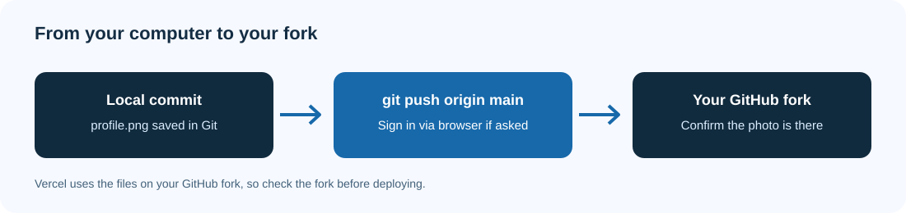
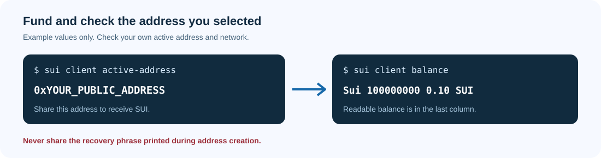
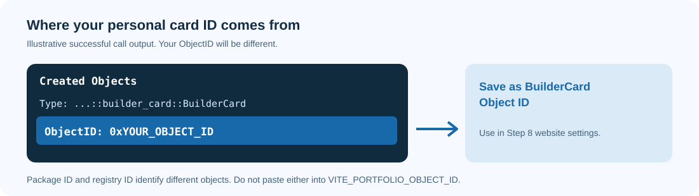
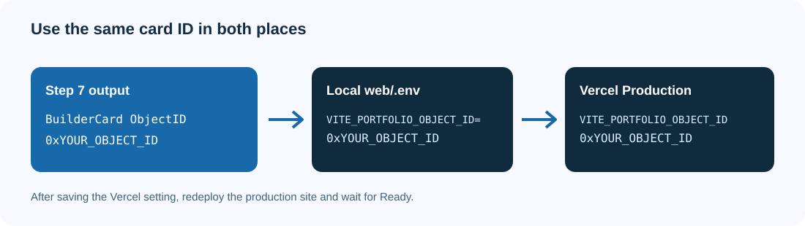

# Cryptita Plays Builder Workshop

Build your own online profile card and publish it on Sui.
You will copy the project, add your photo, put the website online, and create the profile data that the website displays.
No previous blockchain experience is required.

This is the **University of Perpetual Help System Laguna 2026 workshop guide**.
The `main` branch includes two frontend exercises: remove the returning insects and redesign the card.
Complete the [frontend challenges](docs/workshops/frontend-challenges.md) after you can run the website in Step 3.
Those exercises work with an empty card and do not require SUI.

**This guide is for Windows and PowerShell only.**
Mac users should use the complete [macOS guide](docs/workshops/macos.md).
See [university editions](docs/workshops/editions.md) for earlier workshops.

## Community partners

<table align="center" cellspacing="12">
  <tr>
    <td align="center" valign="middle">
      
    </td>
    <td align="center" valign="middle">
      <a href="https://www.facebook.com/grantix.global">
        
      </a>
    </td>
    <td align="center" valign="middle">
      <a href="https://www.facebook.com/kamiyonstudio">
        
      </a>
    </td>
    <td align="center" valign="middle">
      
      </td>
      <td align="center" valign="middle">
        
      </td>
  </tr>
</table>

## Contents

- [Prerequisites](#prerequisites)
- [Step-by-step workshop path](#step-by-step-workshop-path)
  - [Step 1: Copy the project to your computer](#step-1)
  - [Step 2: Prepare the website and your photo](#step-2)
  - [Step 3: Run the website on your computer](#step-3)
  - [Step 4: Put the website online](#step-4)
  - [Step 5: Set up your Sui address](#step-5)
  - [Step 6: Build and publish your card program](#step-6)
  - [Step 7: Create your personal card](#step-7)
  - [Step 8: Connect the website to your card](#step-8)
  - [Step 9: Check your finished website](#step-9)
  - [Complete the frontend challenges](#complete-the-frontend-challenges)
- [Essential resources](#essential-resources)
- [Troubleshooting](#troubleshooting)
- [Change or reset the displayed card](#change-or-reset-the-displayed-card)
- [License](#license)

## Prerequisites

You need a Windows 10 or 11 computer, internet access, and permission to install software.
These instructions use the Windows x64 Sui package.
For a school-managed computer without administrator access, ask your IT administrator to install the tools first.

Create a [GitHub account](https://github.com/signup).
GitHub stores your copy of the project.
Create a [Vercel account](https://vercel.com/signup) using **Continue with GitHub**.
Vercel puts your website online.

### Install the tools with PowerShell

A terminal is a window where you type commands.
PowerShell is the terminal shell used throughout this guide.

1. Open **Start** and search for **Windows PowerShell**.
2. Right-click it and select **Run as administrator**.
3. Select **Yes** when Windows asks for permission.
4. Check whether Chocolatey is installed:

```powershell
choco --version
```

If you see a version number, skip the next code block.
If PowerShell says that `choco` is not recognized, run this block to install Chocolatey.
It downloads and runs the [official Chocolatey installer](https://docs.chocolatey.org/en-us/choco/setup/).
The execution-policy change applies only to this PowerShell window.

```powershell
Set-ExecutionPolicy Bypass -Scope Process -Force
[System.Net.ServicePointManager]::SecurityProtocol = [System.Net.ServicePointManager]::SecurityProtocol -bor 3072
iex ((New-Object System.Net.WebClient).DownloadString('https://community.chocolatey.org/install.ps1'))
```

Close the window and open **Windows PowerShell as administrator** again.
Run each line below and wait for it to finish before running the next:

```powershell
choco --version
choco install nodejs-lts git vscode sui -y
```

This installs Node.js and npm for the website, Git for downloading and saving code, VS Code for editing files, and the Sui command-line interface (CLI).
The `-y` option accepts the package installation prompts.
If a package fails, stop and read the error before continuing.

Close all PowerShell and VS Code windows.
If an installer requests a Windows restart, restart first.
Open a **normal PowerShell window**, without administrator mode, and check:

```powershell
node --version
npm --version
git --version
code --version
sui --version
```

**Check:** all five commands print version information.
Use a supported Node.js LTS version, such as Node 24 or newer.
Do not continue with a command that says "not recognized" or fails to start.
See [Troubleshooting](#troubleshooting).

### Use the correct folder in VS Code

Copy only the text inside a code block.
Press **Enter** to run a command and wait for the prompt to return.
Replace examples such as `YOUR_GITHUB_USERNAME` with your own values.
Keep quotation marks when shown.
If a command fails, fix that step before moving on.

Open the project folder in VS Code, then select **Terminal > New Terminal**.
If the terminal is not PowerShell, use the arrow beside the terminal's **+** button to select **PowerShell**.

A *directory* means a folder.
The *project root* is the folder containing both `web` and `move`.

```powershell
Get-Location
Get-ChildItem
```

The first command shows your current folder.
The second lists its contents.
`cd web` enters the website folder.
`cd ..` moves up one folder.

**To open a terminal in the right folder every time:**

1. In VS Code's Explorer panel, right-click the `web` or `move` folder.
2. Select **Open in Integrated Terminal**.
3. Run `Get-Location` and check that the path ends in that folder's name.

When a step says **project root**, right-click the top project folder and select **Open in Integrated Terminal**.
If that option is unavailable, right-click the project folder and select **Copy Path**.
Enter `Set-Location "PASTE_THE_COPIED_PATH_HERE"`, replacing the example with the copied path.
Each terminal has its own current folder.
Opening a file does not change the terminal's folder.

## Step-by-step workshop path

Complete these steps in order.
Keep a private note with your website URL, Package ID, and BuilderCard Object ID.
You will receive each value in a later step.

The website displays data but cannot create or edit blockchain records.
You create those records with Sui commands.
*Mainnet* is Sui's real network.
*Gas* is the SUI fee paid to run a transaction.

<h3 id="step-1"></h3>

A *fork* is your own copy of a project on GitHub.
*Clone* means download that copy to your computer.

1. Open the [workshop repository](https://github.com/owenlim225/CRYPTITAPLAYS_BuilderWorkshop2026).
2. Click **Star** in the upper-right corner of the repository page.
3. Click **Fork**.
4. Set **Owner** to your account.
5. Name the repository `CRYPTITAPLAYS_BuilderWorkshop2026_LastName`, replacing `LastName` with your surname.
6. Select **Copy the main branch only**, then **Create fork**.
7. On your fork's page, select **Code > HTTPS** and copy the URL.


Open a normal PowerShell window.
Create a folder for your workshop projects:

```powershell
New-Item -ItemType Directory -Force -Path "$env:USERPROFILE\workshops"
Set-Location "$env:USERPROFILE\workshops"
```

Replace the URL and folder name below with your fork's values.
Run the lines one at a time:

```powershell
git clone https://github.com/YOUR_GITHUB_USERNAME/CRYPTITAPLAYS_BuilderWorkshop2026_LastName.git
cd CRYPTITAPLAYS_BuilderWorkshop2026_LastName
code .
```

The dot in `code .` means "open this folder in VS Code."
If VS Code asks whether you trust the project, review the source and trust your workshop copy.

**Check:** VS Code's Explorer shows `web`, `move`, and `README.md`.
If you only see the files inside `web`, use **File > Open Folder** to open its parent project folder.

<h3 id="step-2"></h3>

**Terminal folder: `web`.**
Right-click `web` in VS Code and select **Open in Integrated Terminal**.

```powershell
Get-Location
npm install
```

`npm install` installs the website dependencies.
Wait for installation to finish successfully.

The `web/.env` settings file is included in the repository.
In VS Code, open `web/.env` and confirm the network and chain settings.
Clear `VITE_PORTFOLIO_OBJECT_ID` to start with a placeholder card.
Save with **Ctrl+S**.

Replace `web/public/assets/profile.png` with your photo.
Use an actual PNG image and keep the exact name `profile.png`.
Renaming a JPG file to `.png` does not convert the image.
For a JPG, open it in Paint and use **File > Save as > PNG picture**.
A square photo works well.


**Check:** the file is inside `web/public/assets` and is named `profile.png`, not `profile.png.png`.

<h3 id="step-3"></h3>

**Terminal folder: `web`.**

```powershell
npm run dev
```

Open the **Local** URL printed in the terminal.
It is usually `http://localhost:5173`, but the number can change if that port is busy.

**Check:** your photo appears on the card.
Blank profile fields and a grey status dot are expected because you have not created your card data yet.
The starter's returning insects are part of the [frontend challenges](docs/workshops/frontend-challenges.md).

Keep this terminal open while you use the local website.
To stop the website, click inside the terminal and press **Ctrl+C**.
If PowerShell asks to terminate the batch job, type `Y` and press **Enter**.
You can open another terminal for later steps.

<h3 id="step-4"></h3>

*Deploy* means publish the website so other people can open it.
First, upload your photo change to your GitHub fork.

**Terminal folder: project root.**

```powershell
Get-Location
git status
git branch --show-current
```

**Check:** the branch is `main`.
If it is not, reopen the fork you cloned in Step 1 before continuing.

If Git keeps using a different GitHub account, remove the saved GitHub credential in Windows Credential Manager so Git can ask you to sign in again:

```powershell
cmdkey /delete:git:https://github.com
```

This signs Git out of GitHub on this computer; skip it if Git already uses the correct account.
Set the name and email that Git attaches to commits.
These global settings also apply to your other Git repositories on this computer.
Replace both examples with your own details.
Use your GitHub account email, or the private commit email shown in **GitHub Settings > Emails**.

```powershell
git config --global user.name "YOUR_GITHUB_USERNAME"
git config --global user.email "YOUR_GITHUB_EMAIL"
git add web/public/assets/profile.png
git commit -m "Customize profile photo"
git push origin main
```

A *commit* saves a named set of changes.
*Push* uploads those commits.
When `git push` opens GitHub in your browser, sign in to the account that owns your fork and approve Git's request, then return to the terminal and wait for the push to finish.
If Git says "nothing to commit", check whether the correct photo is already on your fork.



Open your fork on GitHub and confirm that `web/public/assets/profile.png` is your photo.
Vercel builds from GitHub, so files saved only on your computer will not appear online.
If you completed the frontend challenges, follow their save-and-push instructions before deploying.

1. Open [Vercel's new-project page](https://vercel.com/new) and sign in with GitHub.
2. Import your fork.
3. If your fork is missing, use **Adjust GitHub App Permissions** to grant Vercel access to it.
4. Set **Root Directory** to `web`.
5. Confirm **Framework Preset** is Vite, **Build Command** is `npm run build`, and **Output Directory** is `dist`.
6. Under **Environment Variables**, add `VITE_SUI_NETWORK` with value `mainnet` and `VITE_CHAIN` with value `sui`.
7. Leave `VITE_PORTFOLIO_OBJECT_ID` unset for now.
8. Click **Deploy** and wait for success.
9. Open the project dashboard and copy the production domain, such as `https://your-project.vercel.app`.


Use the stable project domain.
Do not copy a preview URL with a random deployment identifier.
Save the URL in your notes without a final `/`.

**Check:** the URL opens in a private browser window without a Vercel login, shows Mainnet, and displays your photo.
The profile fields remain blank until Step 8.
If access is blocked, review **Deployment Protection** in the project's settings and allow public access to the production site.

<h3 id="step-5"></h3>

**Terminal folder: project root.**
Sui account commands work from any folder.

Your Sui *address* is the public identifier that receives SUI and owns your card.
A *recovery phrase* or private key controls that address.
Keep it private and backed up offline.
Never put it in GitHub, Vercel, website settings, a QR code, or a screenshot you share.
CLI output can reveal the recovery phrase, so check and redact it before copying output or sharing a screenshot.

```powershell
sui client addresses
```

If asked to create a configuration, answer `y`.
On some CLI versions, this command also generates a keypair and prints its `secret recovery phrase` before listing addresses.
Record that phrase privately when it appears; anyone who has it can control the address.
In the address table, `address` is the public `0x...` address, and `*` under `active address` marks the one currently selected.
Some CLI versions also ask for a server URL, environment alias, and key scheme.
If those prompts appear, use these answers:

- Server URL: `https://fullnode.mainnet.sui.io:443`.
- Environment alias: `mainnet`.
- Key scheme: `0` for ed25519.

If the CLI creates a default Testnet configuration automatically, continue below.
If you already have a configuration, `sui client addresses` lists the existing addresses.

List your configured networks:

```powershell
sui client envs
```

Only if `mainnet` is missing, add it:

```powershell
sui client new-env --alias mainnet --rpc https://fullnode.mainnet.sui.io:443
```

Switch to Mainnet and check your address:

```powershell
sui client switch --env mainnet
sui client active-env
sui client active-address
```

If there is no active address, create one and select it.
You can also use `new-address` to create a separate address when one is already active.
Its output shows an `address` field containing the public `0x...` address and a `recoveryPhrase` field containing the secret phrase; the address is not a private key.
Creating an address may leave the previous address active.
Replace `0xYOUR_ADDRESS` with the public `address` field from the creation output, then confirm `active-address` prints that same value:

```powershell
sui client new-address ed25519
sui client switch --address 0xYOUR_ADDRESS
sui client active-address
```

**Check:** the active network is `mainnet`, and the active address starts with `0x`.

Give that **public address** to the workshop's technical facilitator to receive Mainnet SUI for transaction fees.
If a QR code is requested, paste only the public address into the [text QR generator](https://www.qr-code-generator.com/solutions/text-qr-code/).
For study outside an event, you must arrange Mainnet funding before continuing.
There is no free Mainnet faucet.
You can still complete the local frontend exercises without funding.

```powershell
sui client balance
```



**Check:** the command returns a positive SUI balance.
If it returns zero, wait for funding.
If it returns an error, use [Troubleshooting](#troubleshooting).
A positive balance alone does not guarantee enough gas for every transaction.

<h3 id="step-6"></h3>

**Terminal folder: `move`.**
Right-click `move` in VS Code and select **Open in Integrated Terminal**.

```powershell
Get-Location
sui move build
sui move test
```

*Build* checks and prepares the Move program.
*Test* runs its automated checks.
**Check:** both commands succeed before you publish.

Publishing puts the program on Mainnet and spends SUI.
Confirm your network and funded address immediately before publishing:

```powershell
sui client active-env
sui client active-address
sui client balance
```

Continue only when the network is `mainnet` and the address is the one you funded.

```powershell
sui client publish
```

This CLI estimates the gas budget with a dry run when you omit `--gas-budget`; you still need enough SUI to pay the actual fee.
Wait for the transaction result.
If the connection drops or the result is uncertain, check your address's transactions on [Suiscan](https://suiscan.xyz/mainnet) before retrying.
Repeating a successful publish spends more SUI.

Find **Published Objects** in the successful output.
Copy its **PackageID** and save it as **Package ID** in your notes.
Do not copy the transaction digest.


**Check:** you have a Package ID beginning with `0x`.
This ID identifies your published program.
It is not the ID of your personal card.

<h3 id="step-7"></h3>

**Terminal folder: `move`.**

Before running this command, review every profile value.
The values become public on-chain, including the `about` text that the website does not display.
This workshop has no edit or delete command for a created card.
Do not enter information you do not want public.

You will use three different IDs:

| Value | Where it comes from | Where you use it |
| --- | --- | --- |
| Package ID | Your successful publish in Step 6 | After `--package` |
| Registry object ID | Fixed workshop value below | First value after `--args` |
| BuilderCard Object ID | Successful card creation in this step | Website settings in Step 8 |

Copy the following command into a temporary text editor first.
Replace `0xYOUR_PACKAGE_ID`, every `Your ...` example, and the website URL.
Replace the sample skills and workshop-learning description with your own text too.
Adjust `PH` and `2026` if needed.
Keep `2026` as this workshop's issue value.
Use three or four skills separated by commas.
Use your Step 4 website URL without a final `/`.

The profile fields are ordered as follows:
name, profession, program, country, specialization, building-since year, focus, community, skills, issue value, about, and website URL.
Keep all twelve quoted values in that order.
Do not change the long registry ID or add a builder number.

In PowerShell, the backtick at the end of each continued line must have **no spaces after it**.
Paste the whole edited block into the terminal:

```powershell
sui client call `
  --package 0xYOUR_PACKAGE_ID `
  --module builder_card `
  --function create_builder_card `
  --args `
    0x297cb610c0c47edc1e12008812f28cd8a1f35f95bb406d45f4b76fa9fda2e04c `
    "Your Name" `
    "Your Profession" `
    "Your Program" `
    "PH" `
    "Your Specialization" `
    "2026" `
    "Your Focus" `
    "Your Community" `
    "Skill One, Skill Two, Skill Three" `
    "2026" `
    "A short description of your workshop learning." `
    "https://your-site.vercel.app" `
  --gas-budget 10000000
```

If the call fails, fix the error before continuing.
If the result is uncertain, check Suiscan before running the command again.
Each successful call creates another card and spends SUI.

In the successful output, find the **Created Objects** entry whose type ends with `::builder_card::BuilderCard`.
Copy that entry's **ObjectID** into your notes as **BuilderCard Object ID**.
The registry assigns your builder number automatically.



Open `https://suiscan.xyz/mainnet/object/0xYOUR_OBJECT_ID/fields` in your browser after replacing the example ID.

**Check:** Suiscan shows your name and the website URL you entered.

<h3 id="step-8"></h3>

In VS Code, open `web/.env`.
Replace `0xYOUR_OBJECT_ID` below with the **BuilderCard Object ID** from Step 7:

```env
VITE_PORTFOLIO_OBJECT_ID=0xYOUR_OBJECT_ID
VITE_SUI_NETWORK=mainnet
VITE_CHAIN=sui
```

Save the file.
Do not use the Package ID or the registry ID here.
The `.env` file contains public website settings and is included in the repository.
All `VITE_*` settings are public in the built website, so never put secrets in them.

Changes to `.env` do not update Vercel automatically.

1. Open your project in Vercel.
2. Select **Settings > Environment Variables**.
3. Add `VITE_PORTFOLIO_OBJECT_ID` with your real BuilderCard Object ID.
4. Confirm `VITE_SUI_NETWORK=mainnet` and `VITE_CHAIN=sui` are still present.
5. Apply all three settings to **Production** and save.
6. Open **Deployments**, select the latest production deployment's menu, and choose **Redeploy**.
7. Wait for the new deployment to show **Ready**.




If Vercel offers **Import .env**, you can import your completed `web/.env` instead of typing its values.
Confirm the existing network and chain settings are updated rather than duplicated.

**Check:** all three settings exist for Production, and the redeployment succeeded.
Changing settings does not update a website that was already built.

<h3 id="step-9"></h3>

For a local check, stop any running development server with **Ctrl+C**.
Open a terminal in `web` and run:

```powershell
npm run build
npm run preview
```

Open the local URL printed by the preview command.
Also open your stable Vercel URL in a private browser window.

Check both sites:

- Your name, profession, and skills appear.
- Your photo appears.
- The network is Mainnet.
- The Object ID matches your notes.
- No loading or error message remains.

A green dot alone is not proof that the card loaded.
Check the actual profile fields too.
On Suiscan, check that the website link and profile image open.


You can export your loaded card with the GIF or Camera button.
The Camera button downloads a PNG.
These exports happen in your browser.
The LinkedIn button opens a draft share for you to review and publish.
To tag a partner, select its page from LinkedIn's suggestions after pasting the caption.

## Complete the frontend challenges

Complete both [frontend challenges](docs/workshops/frontend-challenges.md): remove the returning insects and redesign the card.
Follow the challenge completion checks and share your results with your workshop submission.
Complete the [workshop submission form](https://forms.gle/UDkMqhAU3z2ekFn66).

## Essential resources

- [Frontend challenges](docs/workshops/frontend-challenges.md): remove the insects and redesign the card.
- [University editions](docs/workshops/editions.md): earlier workshop versions.
- [Sui installation](https://docs.sui.io/getting-started/onboarding/sui-install) and [client setup](https://docs.sui.io/getting-started/onboarding/configure-sui-client).
- [Chocolatey installation](https://docs.chocolatey.org/en-us/choco/setup/).
- [Node.js](https://nodejs.org/) and [VS Code](https://code.visualstudio.com/).
- [Suiscan Mainnet](https://suiscan.xyz/mainnet): inspect your transactions and card.
- [Shared builder registry](https://github.com/Cryptita-Plays/cryptita-builder-registry).
- [Vercel](https://vercel.com/): manage your hosted website.

The `web` folder contains the React website.
The `move` folder contains the Sui Move program.
The `docs` folder contains workshop guides and screenshots.
The website reads your card from Sui through GraphQL.
The photo stays in `web/public/assets/profile.png`.

## Troubleshooting

Stop at the first failing step.
Save the command, error message, and output of `Get-Location`.
Remove recovery phrases and private keys before sharing any output.

### A command is not recognized

Close all PowerShell and VS Code windows, then reopen them.
Run the version checks in [Prerequisites](#prerequisites) again.

If PowerShell says `npm.ps1 cannot be loaded because running scripts is disabled`, use `npm.cmd` for that command, such as `npm.cmd install`.
This runs npm without changing PowerShell's execution policy.

If `sui` still fails, run:

```powershell
Get-Command sui.exe -ErrorAction SilentlyContinue
```

If no path appears, check that Chocolatey reported a successful Sui installation.
Retry only the failed package in an administrator PowerShell window:

```powershell
choco install sui -y
```

For an installation outside Chocolatey, find `sui.exe` and add its containing folder to your Windows **User Path**.
Search Start for **Edit environment variables for your account**, then select **Path > Edit > New**.
Add the folder, save, and restart all terminals.
Do not delete existing Path entries.

If `code` is not recognized, you can still open VS Code from Start and use **File > Open Folder**.

### Sui fails with a DLL error

If Windows names `VCRUNTIME140.dll`, `VCRUNTIME140_1.dll`, or `MSVCP140.dll`, install the Microsoft runtime.
In administrator PowerShell, run:

```powershell
choco install vcredist140 -y
```

Restart if requested, open a new normal terminal, and run `sui --version`.

### The terminal is in the wrong folder

If npm cannot find `package.json`, open a terminal in `web`.
If Sui cannot find `Move.toml`, open a terminal in `move`.
Use VS Code's **Open in Integrated Terminal** on the correct folder.
Do not keep entering `cd web` when you are already inside `web`.

### Git cannot save or upload

For "Author identity unknown", run the two `git config` commands in Step 4 with your own details.
For "Permission denied" or "Repository not found", run `git remote -v`.
The URL must belong to your fork, and Git's sign-in must use the account that owns it.
If Git reports that your branch is behind, review the changes on GitHub before reconciling them.
Do not force-push.

### Sui cannot connect or has no gas

Run `sui client active-env`, `sui client envs`, and `sui client active-address`.
Confirm Mainnet uses `https://fullnode.mainnet.sui.io:443` and that you funded the active address.

A timeout is a connection problem, not proof of a zero balance.
Try another permitted internet connection.
If your network allows it, [Cloudflare WARP](https://developers.cloudflare.com/warp-client/get-started/windows/) in WARP mode can help test routing issues.
A returned balance of zero means the connection works but the address still needs funding.

If Sui reports no usable gas coin despite a positive balance, check the [Sui address-balance guidance](https://www.docs.sui.io/onchain-finance/asset-custody/address-balances/using-address-balances) and your CLI version before retrying.
Do not repeatedly publish or create cards to test funding.

### The create command fails

Confirm that `--package` contains your Package ID.
Keep the fixed registry ID first, followed by all twelve quoted values.
In PowerShell, remove spaces after continuation backticks.
If the multiline paste still fails, join the lines into one line and remove the continuation backticks.

If Sui reports an unsupported protocol or compiler version, compare your `sui --version` with the [current installation guidance](https://docs.sui.io/getting-started/onboarding/sui-install).
Update through your package manager if needed, then repeat the build and test checks before any new transaction.

### The website is empty or shows an error

Check the BuilderCard Object ID and `VITE_SUI_NETWORK=mainnet`.
For the local site, save `.env`, stop the server, and start it again.
For Vercel, confirm the settings apply to Production and redeploy.
If the card is still missing, open its Object ID on Suiscan and confirm the type is `::builder_card::BuilderCard`.

For a missing photo, check the exact filename and that your change reached GitHub.
Open your production URL followed by `/assets/profile.png` to test the image directly.

## Change or reset the displayed card

To display a different card, use its Object ID in both the local and Vercel settings.
Restart the local server and redeploy Vercel.
Creating another card requires another successful Step 7 transaction.

To show an empty card, clear only `VITE_PORTFOLIO_OBJECT_ID=` and rebuild or restart.
Keep the network setting.
This changes what the website displays.
It does not remove the old on-chain data.

Clear the Object ID in `web/.env` before sharing a starter without a card.
Keep `move/Move.lock`; do not delete it as a routine troubleshooting step.

## License

Workshop educational use.
Cryptita Plays branding and partner assets belong to their respective owners.
